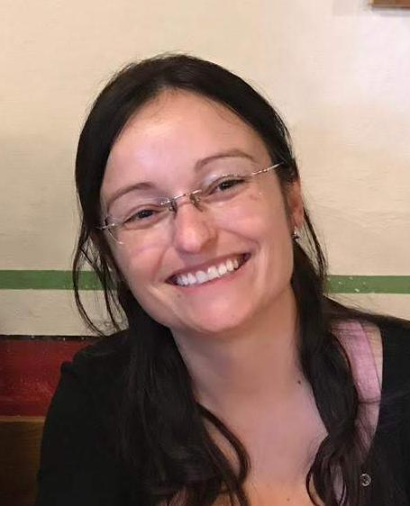
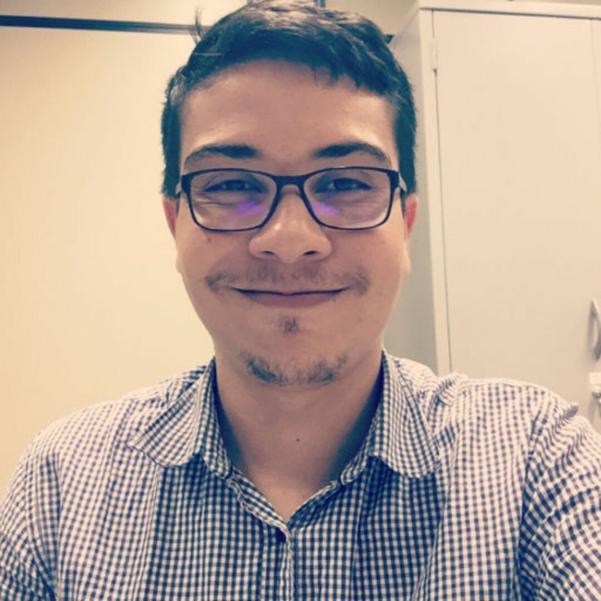
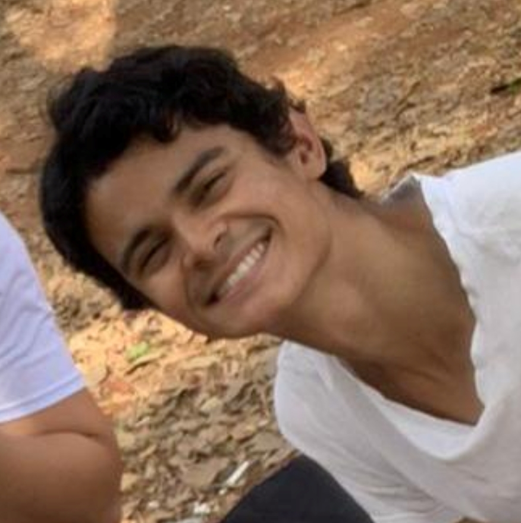
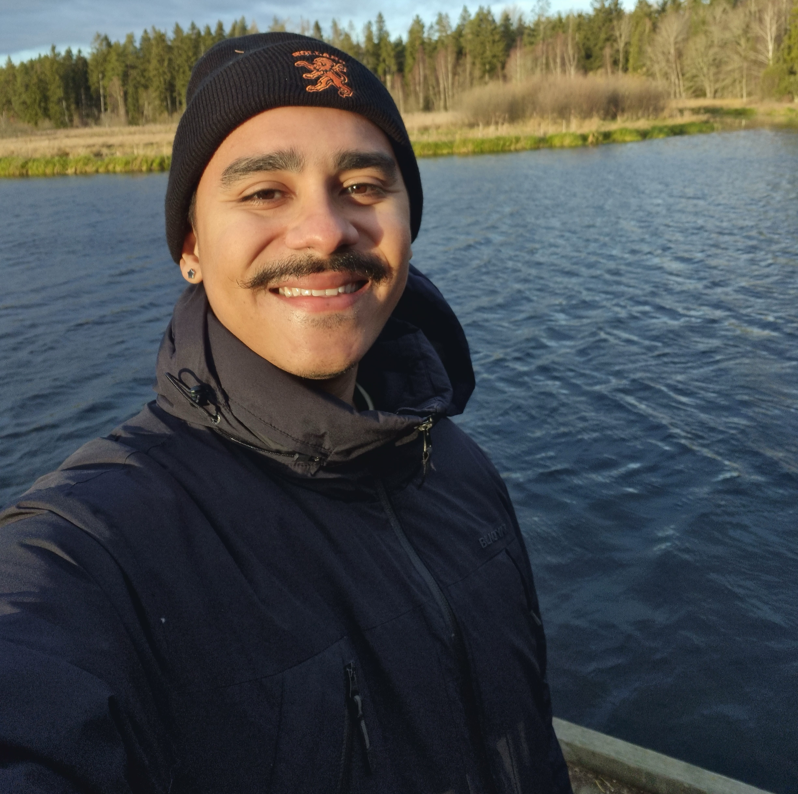

# Equipe

Conheça a equipe que mantém o **Servidor do LGBio** ativo!

## :material-account-star: Equipe de Manutenção

- { .team-photo }

    **Profa. Renata de Oliveira Dias**

    [:material-school: <u>Lattes</u>](http://lattes.cnpq.br/5189684087836977){ target="_blank" rel="noopener"}

- { .team-photo }

    **Prof. Rhewter Nunes**

    [:material-school: <u>Lattes</u>](http://lattes.cnpq.br/6169806655018346){ target="_blank" rel="noopener"}

- { .team-photo }

    **Me. Héctor Antônio Assunção Romão**

    [:material-school: <u>Lattes</u>](http://lattes.cnpq.br/9152652191665275){ target="_blank" rel="noopener"}

- { .team-photo }

    **Dr. Jomal Rodrigues Barbosa Filho**

    [:material-school: <u>Lattes</u>](http://lattes.cnpq.br/6926320216897340){ target="_blank" rel="noopener"}

