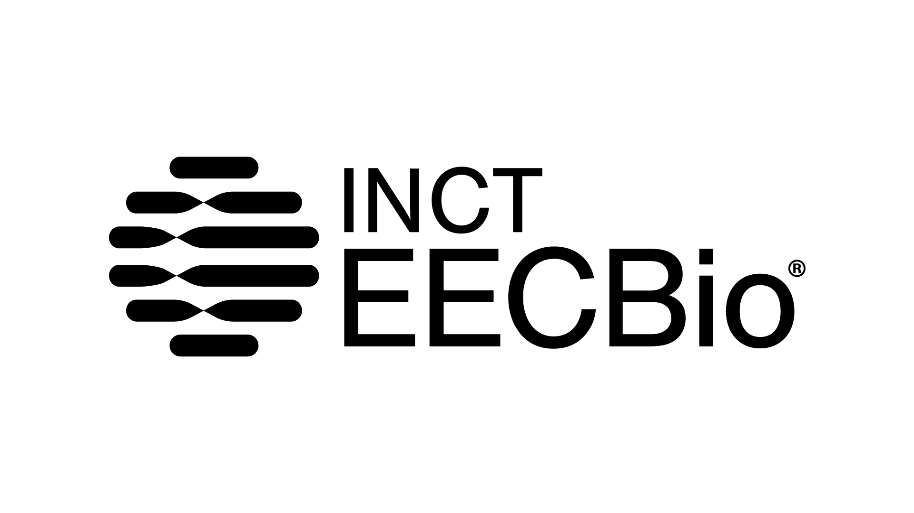

# __Bancos de Dados__

??? info "Página em construção."

---
Nesta página estão listados os bancos de dados atualmente disponíveis globalmente no servidor do LGBio.

!!! note "Solicitação de novos bancos de dados"

    Caso necessite de um banco de dados padrão que não esteja disponível nesta lista, solicite sua instalação por meio do formulário disponível na página inicial. Se desejar disponibilizar um banco de dados customizado para todos os usuários do servidor, entre em contato com os administradores pela aba "Contato".

| Banco de Dados | Última atualização | Descrição | Repositório |
|:---|:---:|:---|:---:|
| **BLAST – core_nt** | - | - | - |
| **BLAST – nr** | - | - | - |
| **BLAST – nt** | - | - | - |
| **BLAST – refseq_protein** | - | - | - |
| **CheckM2** | - | - | - |
| **GTDB-Tk** | - | - | - |
| **Interpro Scan** | - | - | - |
| **EggNog** | - | - | - |
| **Diamond** | - | - | - |
| **Unite** | - | - | - |

 

    

© 2026 • LGBio • Universidade Federal de Goiás

