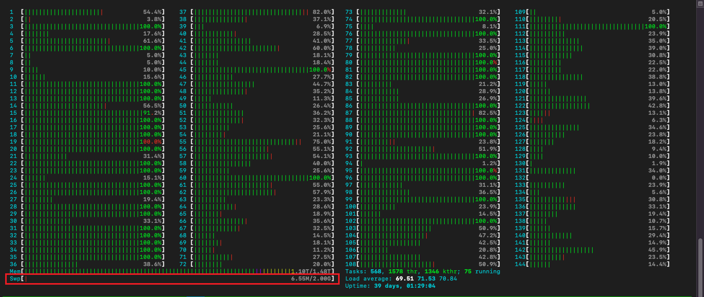
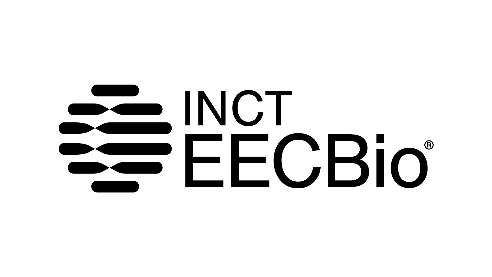

# __Guia de Boas Práticas do Usuário__
---

_Manual elaborado por: Walter Rosa_   
_Última atualização em: 23/11/2026, por Jomal Filho_  

---

!!! danger "Atenção"
    O Servidor LGBio/UFG destina-se exclusivamente a **atividades acadêmicas e de pesquisa**. Seu uso para fins comerciais particulares ou pessoais, sem relação com as atividades institucionais, não é permitido.

__1) Senhas__

- Use senhas fortes e únicas, utilizando uma combinação de letras maiúsculas e minúsculas, números e caracteres especiais.
- Não compartilhe suas senhas com ninguém, mesmo que seja outro colega de trabalho.
- Não armazene senhas em arquivos de texto, scripts ou diretórios compartilhados.
- Caso esqueça a senha e/ou tenha problema com acesso, notifique imediatamente a equipe de administração pelo e-mail _lgbio.server@gmail.com_.

 

__2) Uso das threads e da memória__

- Sempre verifique o estado de uso do servidor. Se perceber que o servidor está usando o *swap*, por exemplo, não executar novas tarefas e reportar a equipe de administração.

    

- Ao desenvolver ou executar tarefas no servidor, **evite o uso excessivo de threads e memória**, o que pode levar à sobrecarga do servidor e a problemas de desempenho.
- O uso de threads será limitado a **16 núcleos por usuário**. Caso o uso ultrapasse esse limite, a tarefa poderá ser interrompida sem aviso prévio.
- Casos excepcionais de uso acima dos limites estipulados poderão ser aceitos, porém por um período limitado de tempo. Para estes casos, é necessário solicitar autorização por e-mail à equipe de administração do servidor através do e-mail _lgbio.server@gmail.com_.

 

__3) Remoção de arquivos que não estão mais em uso__ 

- O servidor não deve ser utilizado como backup de dados, portanto, armazene os arquivos somente pelo tempo necessário para analisá-los e posteriormente os exclua.
- Mantenha cópias de segurança de dados importantes e scripts em locais de armazenamento apropriados, **fora do servidor**. Como não há backup automático dos arquivos pessoais armazenados no servidor, **cada usuário é responsável por manter cópias de seus dados** e prevenir possíveis perdas.
- Remova **regularmente** arquivos desnecessários, intermediários ou antigos do servidor.
- Sempre que possível, compacte arquivos grandes, como _FASTQ_ e _SAM_, após sua utilização, quando não houver necessidade de mantê-los descompactados para análises posteriores. 
- Essas ações visam liberar espaço em disco e garantir a disponibilidade de recursos para todos usuários.

 

__4) Agradecimentos em trabalhos__

- O servidor é um recurso importante para o desenvolvimento do seu trabalho e deve ser devidamente reconhecido. Utilize a seguinte declaração em seus trabalhos: *“This work was supported by the National Institute of Science and Technology (INCT) in Ecology, Evolution, and Biodiversity Conservation, funded by CNPq (grant 409197/2024-6) and FAPEG (grant 201810267000023), linked to the Laboratory of Genetics & Biodiversity (LGBio).*”*.*
- Ao publicar um artigo que utilizou o servidor, envie uma cópia do mesmo para a equipe de administração do servidor. Isso ajudará a controlar o uso do servidor e a demonstrar a importância do recurso para a pesquisa acadêmica.

 

:material-chevron-double-right: [<u>Seguir para Primeiros Passos no Servidor</u>](index_primeiro_acesso.md)

    

© 2026 • LGBio • Universidade Federal de Goiás

