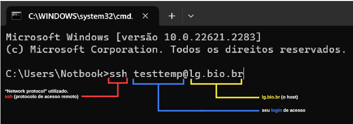
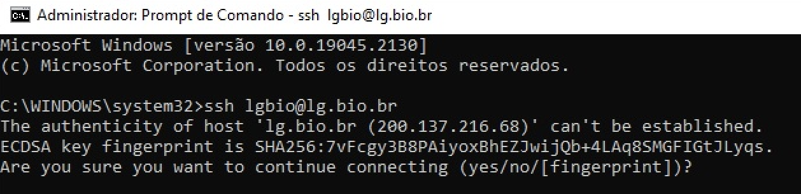
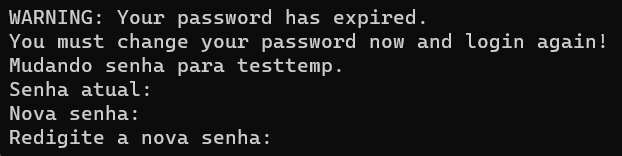
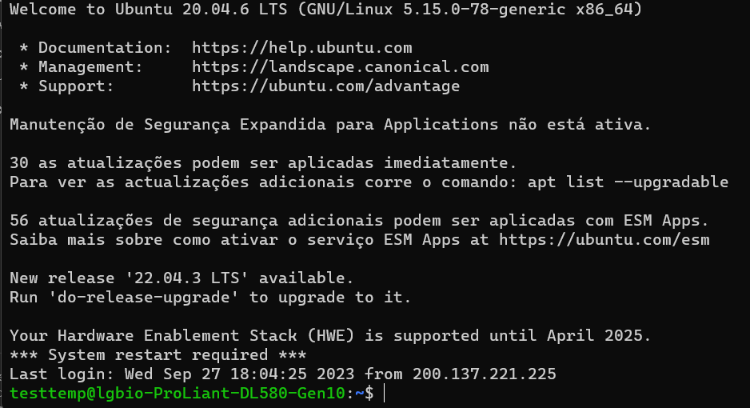
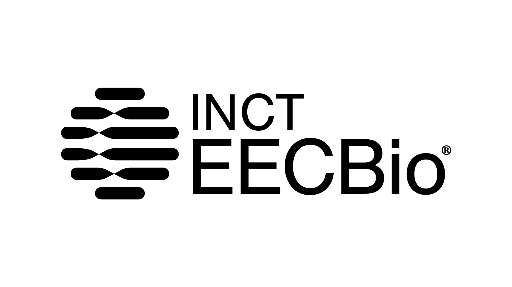

# __Tutorial de Primeiro Acesso ao Servidor do LGBIO__
---

_Tutorial elaborado por: Héctor Romão e Renata Dias_   
_Última atualização em: 23/11/2026, por Jomal Filho_  

---

**:material-numeric-1-circle: Acesse o programa para conectar o servidor por *ssh*:**

- No Mac e no Linux, abra o programa “**Terminal**”;
- No Windows, abra o "**cmd**” / "**prompt de comando**”.

---

**:material-numeric-2-circle: Na tela do programa, digite o seguinte comando e aperte enter** (lembre-se de substituir *"seu_login"* pelo login pessoal que você recebeu por e-mail): 

```bash
ssh seu_login@lg.bio.br -p 53846
```

<p align="center">
    
</p>

<p style="text-align: center; font-size: 1.0em; color: var(--md-default-fg-color--light);">
<b>Figura 1</b> - Exemplo de como ficará a tela do prompt de comando do Windows, seguindo esses passos.
</p>

!!! info "Autenticidade do host"
    No seu primeiro acesso, o sistema operacional pode perguntar se você confia e quer seguir com a conexão ao Servidor (exemplo abaixo). Caso isso ocorra, digite **“yes”** e tecle **enter**.
    <p align="center">
        
    </p>

---

**:material-numeric-3-circle: No primeiro acesso, o sistema irá solicitar que você redefina uma nova senha de acesso.** 

<p align="center">
    
</p>

<p style="text-align: center; font-size: 1.0em; color: var(--md-default-fg-color--light);">
<b>Figura 2</b> - Exemplo de como ficará a tela do terminal na solicitação da senha. A “Senha atual” é aquela que você recebeu por e-mail, junto aos seus dados de login, a “Nova senha” deverá ser a senha altamente segura que você criará.
</p>

!!! warning "Atenção"
    Escolha uma senha que seja **altamente segura!** A segurança do servidor é de responsabilidade de todos!

---

**:material-numeric-4-circle: Uma vez definida a nova senha, o sistema irá solicitar que você se conecte novamente, seguindo os mesmos passos descritos nos itens “1” e “2”.**

---

**:material-numeric-5-circle: A partir de agora, você estará logado no servidor e deverá ver na última linha da tela algo como:**

```bash
seulogin@lgbio-ProLiant-DL580-Gen10:~$
```

<p align="center">
    
</p>

<p style="text-align: center; font-size: 1.0em; color: var(--md-default-fg-color--light);">
<b>Figura 3</b> - Exemplo de como ficará a tela do terminal após a sua conexão.
</p>

---

<p style="text-align: center; font-size: 2.0em; color: var(--md-default-fg-color--light);">
    <b><em><span style="color: #ADC74D;">Prontinho! Tenha uma boa jornada! 🚀</span></em></b>
</p>

<p align="center">
    
</p>

<br>

:material-chevron-double-right: [<u>Seguir para Manual do Usuário</u>](index_manual.md)

<p align="right">
    
</p>

<p style="text-align: center; font-size: 0.8em; color: var(--md-default-fg-color--light);">
© 2026 • LGBio • Universidade Federal de Goiás
</p>