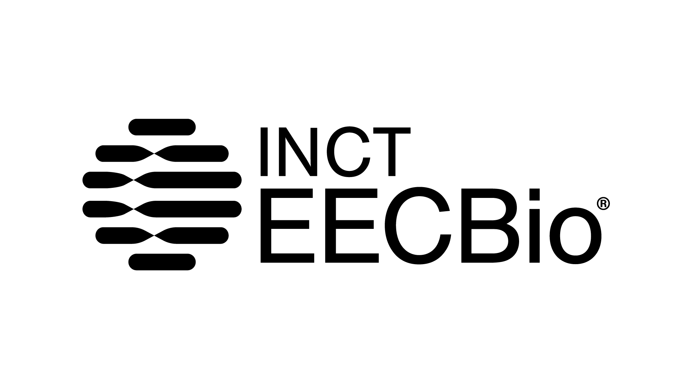

# __Softwares__

Nesta página estão listados os softwares atualmente disponíveis globalmente no servidor do LGBio.

!!! note "Solicitação de Softwares"

    Caso necessite de um software que não esteja disponível nesta lista, solicite a instalação através do formulário disponível na página inicial.

| Programa | Versão | Descrição | Repositório |
|----------|:------:|-----------|:-----------:|
| **ABySS** | 4.2.1 | O ABySS é um montador de sequências de novo, desenvolvido para leituras curtas de extremidades pareadas (paired-end) e genomas de todos os tamanhos. | [:material-github: Link](https://github.com/BirolLab/abyss){ target="_blank" rel="noopener" } |
| **ALTER** | 1.3.4-3 | ALTER significa ALignment Transformation EnviRonment (Ambiente de Transformação de Alinhamentos) e consiste em um conjunto de componentes de software destinados à conversão entre diferentes formatos de arquivos de alinhamento múltiplo de sequências (Multiple Sequence Alignment). | [:material-github: Link](https://github.com/sing-group/ALTER){ target="_blank" rel="noopener" } |
| **AMAP** | 2.2 | Ferramenta de linha de comando em bioinformática usada para realizar alinhamento múltiplo de sequências proteicas. | [:material-github: Link](https://github.com/mes5k/amap-align?tab=readme-ov-file){ target="_blank" rel="noopener" } |
| **AUGUSTUS** | 3.4.0 | O AUGUSTUS é um programa para encontrar genes e suas estruturas em um ou mais genomas. | [:material-github: Link](https://github.com/Gaius-Augustus/Augustus){ target="_blank" rel="noopener" } |
| **Barbell** | 0.3.3 | Ferramenta para análise e modelagem de redes estruturais e biomoleculares. | [:material-github: Link](https://github.com/rickbeeloo/barbell){ target="_blank" rel="noopener" } |
| **Beagle** | 5.1 | Pacote de software para imputação de genótipos, inferência de fase de haplótipos e associação genética. | [:material-github: Link](https://faculty.washington.edu/browning/beagle/beagle.html){ target="_blank" rel="noopener" } |
| **BEDtools** | 2.29.1 | Conjunto poderoso de ferramentas para manipulação e análise de intervalos genômicos (Formatos BED, BAM, VCF, GFF). | [:material-github: Link](https://github.com/arq5x/bedtools2){ target="_blank" rel="noopener" } |
| **Bowtie 2** | 2.4.5 | Ferramenta ultrafasta e eficiente em memória para alinhamento de sequências de DNA curtas a genomas de referência. | [:material-github: Link](https://github.com/BenLangmead/bowtie2){ target="_blank" rel="noopener" } |
| **Bowtie** | 1.2.3 | Alinhador ultrafast e de baixo consumo de memória para leituras curtas de sequências de DNA. | [:material-github: Link](https://github.com/BenLangmead/bowtie){ target="_blank" rel="noopener" } |
| **BWA** | 0.7.17-r1188 | Burrows-Wheeler Aligner (BWA) é um pacote de software para mapeamento de sequências de DNA contra genomas de referência de grande porte. | [:material-github: Link](https://github.com/lh3/bwa){ target="_blank" rel="noopener" } |
| **cdbfasta** | 0.99 | Ferramenta para indexação e recuperação rápida de registros de arquivos FASTA e FASTQ. | [:material-github: Link](https://github.com/gpertea/cdbfasta){ target="_blank" rel="noopener" } |
| **Clustal Omega** | 1.2.4 | Clustal Omega é uma ferramenta de alinhamento múltiplo de sequências (MSA) de alta velocidade para DNA, RNA e proteínas. | [:material-github: Link](https://www.ebi.ac.uk/jdispatcher/msa/clustalo){ target="_blank" rel="noopener" } |
| **ClustalW** | 2.1 | Ferramenta clássica para alinhamento múltiplo de sequências de nucleotídeos ou aminoácidos. | [:material-github: Link](https://www.genome.jp/tools-bin/clustalw){ target="_blank" rel="noopener" } |
| **DIALIGN-TX** | 1.0.2-12 | Segmento atualizado do programa DIALIGN para alinhamento múltiplo de sequências de DNA ou proteínas baseado em segmentos. | [:material-github: Link](https://github.com/GuillaumeDD/dialign){ target="_blank" rel="noopener" } |
| **DIALIGN** | 2.2.1-10 | Ferramenta de alinhamento múltiplo de sequências que compara segmentos sem penalidade de lacunas (gaps) globais. | [:material-github: Link](https://dialign.gobics.de/){ target="_blank" rel="noopener" } |
| **DIAMOND** | 0.9.30.131 | Alinhador altamente eficiente e ultrarrápido para sequências de proteínas e tradução de DNA contra bancos de proteínas. | [:material-github: Link](https://github.com/bbuchfink/diamond){ target="_blank" rel="noopener" } |
| **EMBOSS** | 6.6.0.0 | EMBOSS (European Molecular Biology Open Software Suite) é um pacote integrado de ferramentas gratuitas para análise de dados moleculares. | [:material-github: Link](https://emboss.sourceforge.net/){ target="_blank" rel="noopener" } |
| **Exonerate** | 2.4.0 | Ferramenta versátil para alinhamento de sequências que permite mapear sequências de DNA e proteínas a genomas. | - |
| **FastQC** | 0.11.9 | Ferramenta de controle de qualidade para dados de sequenciamento de alto rendimento (High-Throughput Sequencing). | [:material-github: Link](https://github.com/s-andrews/FastQC){ target="_blank" rel="noopener" } |
| **FSA** | 1.15.9 | Fast Statistical Alignment (FSA) é um alinhador múltiplo de sequências baseado em modelos estatísticos probabilísticos. | - |
| **GEMMA** | 0.98.1 | Genome-wide Efficient Mixed Model Association (GEMMA) é uma ferramenta para estudos de associação genômica ampla (GWAS). | [:material-github: Link](https://github.com/genetics-statistics/GEMMA){ target="_blank" rel="noopener" } |
| **GenomeTools** | 1.6.1 | Conjunto versátil de ferramentas de software para análise e manipulação de genomas e arquivos GFF3. | [:material-github: Link](http://genometools.org/){ target="_blank" rel="noopener" } |
| **GenomeScope 2.0** | - | Estimativa de tamanho de genoma, heterozigosidade e repetições a partir de perfis de k-meros. | [:material-github: Link](https://github.com/tbenavi1/genomescope2.0){ target="_blank" rel="noopener" } |
| **HMMER** | 3.3 | Pacote de software para análise de sequências biológicas utilizando modelos ocultos de Markov (HMMs). | [:material-github: Link](http://hmmer.org/){ target="_blank" rel="noopener" } |
| **HyPhy (MPI)** | 2.5.1 | Versão paralela com suporte a MPI do programa HyPhy para hipóteses de evolução molecular em clusters de computação. | [:material-github: Link](https://github.com/veg/hyphy){ target="_blank" rel="noopener" } |
| **Infernal** | - | INFERNAL (INference of RNA ALignment) busca por homólogos de sequências e estruturas secundárias de RNA em bancos de dados. | [:material-github: Link](http://eddylab.org/infernal/){ target="_blank" rel="noopener" } |
| **IQ-TREE** | 1.6.12 | Software eficiente para inferência filogenética por Máxima Verossimilhança com suporte a seleção de modelos. | [:material-github: Link](https://iqtree.github.io/){ target="_blank" rel="noopener" } |
| **IQ-TREE 2** | 2.2.0 | Software eficiente para inferência filogenética por Máxima Verossimilhança com suporte a seleção de modelos. | [:material-github: Link](https://iqtree.github.io/){ target="_blank" rel="noopener" } |
| **IQ-TREE 3** | 3.0.1 | Software eficiente para inferência filogenética por Máxima Verossimilhança com suporte a seleção de modelos. | [:material-github: Link](https://iqtree.github.io/){ target="_blank" rel="noopener" } |
| **Jellyfish** | 2.3.0 | Ferramenta rápida e eficiente em memória para contagem de k-meros em sequências de DNA. | [:material-github: Link](https://github.com/gmarcais/Jellyfish){ target="_blank" rel="noopener" } |
| **jModelTest** | 2.1.10 | Ferramenta para a seleção estatística de modelos de substituição de nucleotídeos para análises filogenéticas. | [:material-github: Link](https://github.com/ddarriba/jmodeltest2){ target="_blank" rel="noopener" } |
| **Kalign** | 2.04 | Alinhador múltiplo de sequências de DNA e proteínas ultrarrápido projetado para grandes conjuntos de dados. | [:material-github: Link](https://github.com/TimoLassmann/kalign){ target="_blank" rel="noopener" } |
| **MAFFT** | v7.503 | Programa popular de alinhamento múltiplo de sequências de nucleotídeos ou aminoácidos de alta velocidade e precisão. | [:material-github: Link](https://mafft.cbrc.jp/alignment/software/){ target="_blank" rel="noopener" } |
| **MAQ** | 0.7.1 | Mapping and Assembly with Qualities (MAQ) é um alinhador legado de leituras curtas contra genomas de referência. | [:material-github: Link](http://maq.sourceforge.net/){ target="_blank" rel="noopener" } |
| **Mauve** | 2.4.0 | Sistema de alinhamento múltiplo de genomas completos para identificar rearranjos cromossômicos e rearranjos ortólogos. | [:material-github: Link](https://darlinglab.org/mauve/mauve.html){ target="_blank" rel="noopener" } |
| **MCL** | 1.14 | Markov Cluster Algorithm (MCL) é um algoritmo de agrupamento não supervisionado baseado em simulação de fluxos em grafos. | [:material-github: Link](https://micans.org/mcl/){ target="_blank" rel="noopener" } |
| **Minimap2** | 2.24-r1122 | Alinhador versátil para sequências longas de DNA/RNA (PacBio/Nanopore) e montagens contra genomas de referência. | [:material-github: Link](https://github.com/lh3/minimap2){ target="_blank" rel="noopener" } |
| **mothur** | 1.42.1 | Pacote de software completo para processamento e análise de dados de microbioma e amplicons de 16S/18S rRNA. | [:material-github: Link](https://github.com/mothur/mothur){ target="_blank" rel="noopener" } |
| **MUMmer** | 4.0.0beta2 | Sistema versátil para alinhamento rápido de genomas inteiros e comparação de grandes sequências. | [:material-github: Link](https://github.com/mummer4/mummer){ target="_blank" rel="noopener" } |
| **MUMmer (versão pelo bioconda)** | 3.23 | Sistema versátil para alinhamento rápido de genomas inteiros (Versão 3 via Conda). | [:material-github: Link](https://github.com/mummer4/mummer){ target="_blank" rel="noopener" } |
| **MUSCLE** | 3.8.1551 | Multiple Sequence Comparison by Log-Expectation é um software popular para alinhamento de sequências de proteínas e nucleotídeos. | [:material-github: Link](https://www.drive5.com/muscle/){ target="_blank" rel="noopener" } |
| **MUSTANG** | 3.2.3 | Multiple Structural Alignment Algorithm é uma ferramenta para alinhamento estrutural de proteínas em formato PDB. | [:material-github: Link](https://lcb.infotech.monash.edu/mustang/){ target="_blank" rel="noopener" } |
| **NCBI BLAST+** | 2.12.0+ | Suíte oficial do NCBI contendo ferramentas essenciais como blastn, blastp, blastx, tblastn e makeblastdb. | [:material-github: Link](https://blast.ncbi.nlm.nih.gov/){ target="_blank" rel="noopener" } |
| **NCBI Entrez Direct (EDirect)** | - | Entrez Direct (EDirect) permite acesso por linha de comando às bases de dados do NCBI (PubMed, GenBank, etc.). | [:material-github: Link](https://www.ncbi.nlm.nih.gov/books/NBK179288/){ target="_blank" rel="noopener" } |
| **NCOILS** | 2002-7 | Programa para predição de regiões de hélice superenrolada (coiled-coil) em sequências de aminoácidos. | - |
| **EPI2ME Labs Launcher** | - | Interface e ambiente de execução para fluxos de trabalho de análise de dados de sequenciamento Oxford Nanopore. | [:material-github: Link](https://github.com/epi2me-labs){ target="_blank" rel="noopener" } |
| **Guppy (Oxford Nanopore)** | 6.5.7 | Basecaller de alta performance baseado em redes neurais para dados de sequenciamento Oxford Nanopore. | [:material-github: Link](https://community.nanoporetech.com/){ target="_blank" rel="noopener" } |
| **PAML** | 4.9j | Phylogenetic Analysis by Maximum Likelihood é um pacote para análises filogenéticas de sequências de DNA ou proteínas. | [:material-github: Link](https://github.com/abacus-gene/paml){ target="_blank" rel="noopener" } |
| **PHYLIP** | 1:3.697 | PHYLogeny Inference Package é um conjunto completo de programas para inferência de árvores filogenéticas. | [:material-github: Link](https://evolution.genetics.washington.edu/phylip.html){ target="_blank" rel="noopener" } |
| **PhyML** | 3:3.3.20190909-1 | Ferramenta para inferência de árvores filogenéticas por Máxima Verossimilhança a partir de alinhamentos. | [:material-github: Link](https://github.com/stephaneguindon/phyml){ target="_blank" rel="noopener" } |
| **Picard Tools** | 2.18.25 | Conjunto de ferramentas baseadas em Java para manipulação e análise de arquivos no formato SAM/BAM/CRAM. | [:material-github: Link](https://broadinstitute.github.io/picard/){ target="_blank" rel="noopener" } |
| **Pilon** | 1.23 | Ferramenta para correção e melhoria de montagens genômicas usando leituras curtas de alta qualidade. | [:material-github: Link](https://github.com/broadinstitute/pilon){ target="_blank" rel="noopener" } |
| **PLINK 2** | 2.0.0-a.7.1LM | Ferramenta para genética de populações e análise de associação genômica ampla (GWAS) extremamente rápida. | [:material-github: Link](https://www.cog-genomics.org/plink/2.0/){ target="_blank" rel="noopener" } |
| **POA** | 1.0.0 | Partial Order Alignment é uma ferramenta para alinhamento rápido de sequências e geração de consenso baseado em grafos. | [:material-github: Link](https://github.com/Psy-Fer/poa-consensus){ target="_blank" rel="noopener" } |
| **PRANK** | v.170427 | Probabilistic Alignment Kit é um alinhador múltiplo de sequências ciente de eventos de inserção/deleção (indels). | [:material-github: Link](https://prankweb.cz/){ target="_blank" rel="noopener" } |
| **Primer3** | 2.4.0 | Ferramenta amplamente utilizada para desenho automatizado de primers de PCR e sondas de hibridização. | [:material-github: Link](https://github.com/primer3-org/primer3){ target="_blank" rel="noopener" } |
| **Probalign** | 1.4 | Alinhador múltiplo de sequências de proteínas baseado em probabilidades posteriores de partição de matrizes. | [:material-github: Link](https://www.phylo.org/index.php/rest/probalign.html){ target="_blank" rel="noopener" } |
| **ProbCons** | 1.12 | Ferramenta de alinhamento múltiplo de sequências de proteínas baseada em modelos de inconsistência probabilística. | - |
| **ProDA** | 1.0 | Protein Domain Alignment (ProDA) é uma ferramenta para alinhamento de sequências com domínios repetidos ou arranjos em blocos. | [:material-github: Link](https://github.com/const-ae/proDA){ target="_blank" rel="noopener" } |
| **progressiveMauve** | 1.2.0 | Algoritmo aprimorado da suíte Mauve para alinhamento múltiplo de genomas com variações estruturais. | [:material-github: Link](https://darlinglab.org/mauve/mauve.html){ target="_blank" rel="noopener" } |
| **ProtTest** | 3.4.2 | Ferramenta para a seleção do modelo de evolução de proteínas mais adequado para análises filogenéticas. | [:material-github: Link](https://github.com/ddarriba/prottest3){ target="_blank" rel="noopener" } |
| **purge_dups** | 1.2.5 | Ferramenta para identificação e remoção de contigs duplicados de haplótipos em montagens genômicas primárias. | [:material-github: Link](https://github.com/dfguan/purge_dups){ target="_blank" rel="noopener" } |
| **QBrew** | 0.4.1 | Aplicativo auxiliar de cálculo e receitas para fabricação artesanal de cerveja (utilitário do repositório Linux). | - |
| **Quarto** | 1.9.37 | Sistema de publicação científica e técnica de código aberto para criar documentos, relatórios, apresentações e sites. | [:material-github: Link](https://github.com/quarto-dev/quarto-cli){ target="_blank" rel="noopener" } |
| **RagTag** | 2.1.0 | Conjunto de ferramentas de software para estruturação e andaimento (scaffolding) de genomas orientado por referência. | [:material-github: Link](https://github.com/malonge/RagTag){ target="_blank" rel="noopener" } |
| **RAxML** | 8.2.12 | Randomized Axelerated Maximum Likelihood (RAxML) é um software para inferência filogenética por Máxima Verossimilhança. | [:material-github: Link](https://github.com/stamatak/standard-RAxML){ target="_blank" rel="noopener" } |
| **samblaster** | 0.1.24 | Ferramenta rápida para marcar duplicatas de PCR e extrair leituras desalinhadas ou divididas em arquivos SAM. | [:material-github: Link](https://github.com/GregoryFaust/samblaster){ target="_blank" rel="noopener" } |
| **SAMtools** | 1.22 | Conjunto essencial de utilitários para manipulação de alinhamentos nos formatos SAM, BAM e CRAM. | [:material-github: Link](https://github.com/samtools/samtools){ target="_blank" rel="noopener" } |
| **seqtk** | 1.3-1 | Ferramenta ultrarrápida e leve para processamento e manipulação de sequências nos formatos FASTA e FASTQ. | [:material-github: Link](https://github.com/lh3/seqtk){ target="_blank" rel="noopener" } |
| **sim4** | 0.0.20121010-5 | Programa para alinhamento de sequências de expressas (cDNA/mRNA) contra DNA genômico considerando íntrons. | [:material-github: Link](https://pbil.univ-lyon1.fr/members/duret/cours/inserm210604/exercise4/sim4.html){ target="_blank" rel="noopener" } |
| **T-Coffee** | 12.00.7 | Tree-based Consistency Objective Function for alignment Evaluation é uma suíte flexível de alinhamento múltiplo. | [:material-github: Link](https://github.com/cbcrg/tcoffee){ target="_blank" rel="noopener" } |
| **Glimmer** | 3.02b | Sistema Glimmer (Gene Locator and Integrated Markov Modeler) para identificação de genes codificantes em bactérias/vírus. | - |
| **TM-align** | - | Algoritmo para alinhamento de estruturas tridimensionais de proteínas e cálculo do escore TM-score. | [:material-github: Link](https://zhanggroup.org/TM-align/){ target="_blank" rel="noopener" } |
| **TransRate Tools** | 1.0.0 | Ferramentas auxiliares para o software TransRate de avaliação e métricas de qualidade de montagens de transcriptoma. | [:material-github: Link](https://hibberdlab.com/transrate/){ target="_blank" rel="noopener" } |
| **Trimmomatic** | - | Ferramenta flexível de corte e limpeza de leituras FASTQ para remoção de adaptadores e leituras de baixa qualidade. | [:material-github: Link](https://github.com/usadellab/Trimmomatic){ target="_blank" rel="noopener" } |
| **Velvet** | 1.2.09 | Montador de genomas de novo projetado para leituras curtas de sequenciamento baseado em grafos de de Bruijn. | [:material-github: Link](https://github.com/dzerbino/velvet){ target="_blank" rel="noopener" } |
| **Wise2 (GeneWise)** | 2.4.1-21 | Pacote de software Wise2 para alinhamento inteligente de biosequências (ex: comparar proteína com genoma via GeneWise). | [:material-github: Link](https://www.ebi.ac.uk/~birney/wise2/){ target="_blank" rel="noopener" } |

 

# __Ambientes Conda__
| Programa | Versão | Descrição | Repositório |
|----------|:------:|-----------|:-----------:|
| **NanoFilt** | - | Ferramenta de filtragem e recorte para leituras de sequenciamento Oxford Nanopore e PacBio. | [:material-github: Link](https://github.com/wdecoster/nanofilt){ target="_blank" rel="noopener" } |
| **Annotate (Env)** | - | Ambiente/pacote dedicado para anotação funcional e estrutural de sequências genômicas. | [:material-github: Link](https://github.com/){ target="_blank" rel="noopener" } |
| **Antimicrobial (Env)** | - | Conjunto de ferramentas para identificação de genes de resistência a antimicrobianos (AMR). | [:material-github: Link](https://github.com/){ target="_blank" rel="noopener" } |
| **antiSMASH (Env)** | - | Ambiente do antiSMASH para identificação e análise de clusters de genes biossintéticos de metabólitos secundários. | [:material-github: Link](https://github.com/antismash/antismash){ target="_blank" rel="noopener" } |
| **antiSMASH v7 (Env)** | - | Ambiente contendo a versão 7 do antiSMASH para mineração de produtos naturais em genomas. | [:material-github: Link](https://github.com/antismash/antismash){ target="_blank" rel="noopener" } |
| **AutoDock Vina** | - | Ferramenta de acoplamento molecular (molecular docking) rápida e precisa para triagem virtual de ligantes. | [:material-github: Link](https://github.com/ccsb-scripps/AutoDock-Vina){ target="_blank" rel="noopener" } |
| **BayeScan** | - | Programa para detecção de loci sob seleção natural a partir de dados de frequências alélicas usando métodos bayesianos. | [:material-github: Link](http://cmpg.unibe.ch/software/bayescan/){ target="_blank" rel="noopener" } |
| **BiG-SLiCE** | - | Ferramenta de clustering e bioinformática de grande escala para análise de clusters biossintéticos de metabólitos. | [:material-github: Link](https://github.com/medema-group/bigslice){ target="_blank" rel="noopener" } |
| **BiG-SLiCE v1 (Env)** | - | Versão 1 da ferramenta BiG-SLiCE para agrupamento massivo de clusters genômicos de metabólitos secundários. | [:material-github: Link](https://github.com/medema-group/bigslice){ target="_blank" rel="noopener" } |
| **Binning (Env)** | - | Ambiente contendo ferramentas para agrupamento de contigs metagenômicos (metagenomic binning). | [:material-github: Link](https://github.com/){ target="_blank" rel="noopener" } |
| **Biotools (Env)** | - | Conjunto de utilitários e bibliotecas gerais de bioinformática em ambiente Conda. | [:material-github: Link](https://github.com/){ target="_blank" rel="noopener" } |
| **BlobTools** | - | Ferramenta de análise visual e filtragem de contigs em montagens genômicas com base em GC, cobertura e taxonomia. | [:material-github: Link](https://github.com/CGAT-developers/blobtools){ target="_blank" rel="noopener" } |
| **BUSCO** | - | Benchmarking Universal Single-Copy Orthologs é uma ferramenta para avaliar a completude de montagens de genomas/transcriptomas. | [:material-github: Link](https://gitlab.com/ezlab/busco){ target="_blank" rel="noopener" } |
| **CAFE 5** | - | Computational Analysis of gene Family Evolution (CAFE) estima taxas de ganho e perda de famílias de genes ao longo de árvores filogenéticas. | [:material-github: Link](https://github.com/hahnlab/CAFE5){ target="_blank" rel="noopener" } |
| **CONCOCT (Env)** | - | Ambiente do CONCOCT para agrupamento (binning) de contigs metagenômicos usando frequências de k-meros e cobertura. | [:material-github: Link](https://github.com/BinPro/CONCOCT){ target="_blank" rel="noopener" } |
| **eggNOG-mapper** | - | eggNOG-mapper é uma ferramenta para anotação funcional rápida de sequências usando o banco de dados eggNOG. | [:material-github: Link](https://github.com/eggnogdb/eggnog-mapper){ target="_blank" rel="noopener" } |
| **fastcat** | - | Utilitário para concatenação e conversão de arquivos de dados de sequenciamento FASTQ e FASTA. | [:material-github: Link](https://github.com/epi2me-labs/fastcat){ target="_blank" rel="noopener" } |
| **FASTX-Toolkit** | - | Coleção de ferramentas de linha de comando para pré-processamento de dados de sequenciamento FASTA/FASTQ. | [:material-github: Link](http://hannonlab.cshl.edu/fastx_toolkit/){ target="_blank" rel="noopener" } |
| **Flye (Env)** | - | Ambiente do Flye, um montador de genomas de novo projetado para leituras longas (Nanopore / PacBio). | [:material-github: Link](https://github.com/fenderglass/Flye){ target="_blank" rel="noopener" } |
| **SSR-GBAS-GUI** | - | GUI/Ferramenta para análise de marcas de microssatélites (SSR) e associação genômica. | [:material-github: Link](https://github.com/){ target="_blank" rel="noopener" } |
| **GenomeScope 2.0 (Env)** | - | Ambiente Conda configurado com a versão 2 do GenomeScope para análise de perfis de k-meros. | [:material-github: Link](https://github.com/tbenavi1/genomescope2.0){ target="_blank" rel="noopener" } |
| **GUIDANCE2** | - | Servidor e ferramenta para avaliação de confiabilidade e filtragem de posições não alinhadas em alinhamentos múltiplos. | [:material-github: Link](http://guidance.tau.ac.il/){ target="_blank" rel="noopener" } |
| **HERRO** | - | Ferramenta de correção de erros baseada em deep learning para leituras longas de sequenciamento Nanopore. | [:material-github: Link](https://github.com/){ target="_blank" rel="noopener" } |
| **JupyterHub (Env)** | - | Ambiente Python configurado para suporte e execução de serviços JupyterHub no servidor. | [:material-github: Link](https://jupyter.org/){ target="_blank" rel="noopener" } |
| **LongStitch** | - | Pipeline de scaffolding de genomas que combina leituras longas (Nanopore/PacBio) para fechar lacunas de montagem. | [:material-github: Link](https://github.com/bcgsc/longstitch){ target="_blank" rel="noopener" } |
| **LongStitch (Env)** | - | Ambiente Conda com dependências instaladas para execução do pipeline LongStitch. | [:material-github: Link](https://github.com/bcgsc/longstitch){ target="_blank" rel="noopener" } |
| **medaka** | - | Ferramenta da Oxford Nanopore para criação de consenso e polimento de montagens genômicas usando dados de redes neurais. | [:material-github: Link](https://github.com/nanoporetech/medaka){ target="_blank" rel="noopener" } |
| **Metagenomics Training (Env)** | - | Ambiente pedagógico configurado com ferramentas e scripts para treinamento e oficinas de metagenômica. | [:material-github: Link](https://github.com/){ target="_blank" rel="noopener" } |
| **metaMDBG** | - | Montador de metagenomas ultra-eficiente para leituras longas e de alta precisão (PacBio HiFi / Nanopore duplex). | [:material-github: Link](https://github.com/al42and/metaMDBG){ target="_blank" rel="noopener" } |
| **MITOS2** | - | Ferramenta de anotação de genomas mitocondriais metazoários usando modelos de covariância e pesquisas de estrutura. | [:material-github: Link](https://gitlab.com/Bernt/MITOS){ target="_blank" rel="noopener" } |
| **MitoZ** | - | Toolkit para montagem, anotação e controle de qualidade de genomas mitocondriais a partir de sequenciamento genômico. | [:material-github: Link](https://github.com/lincong/MitoZ){ target="_blank" rel="noopener" } |
| **NextDenovo (Env)** | - | Ambiente do NextDenovo, um montador de genomas de novo baseado em leituras longas sem correção prévia. | [:material-github: Link](https://github.com/Nextomics/NextDenovo){ target="_blank" rel="noopener" } |
| **Nextstrain** | - | Ferramenta de código aberto para rastreamento em tempo real da evolução de patógenos e análise filodinâmica. | [:material-github: Link](https://github.com/nextstrain/cli){ target="_blank" rel="noopener" } |
| **ntLink (Env)** | - | Ambiente da ferramenta ntLink para scaffolding leve e montagem de genomas usando k-meros de leituras longas. | [:material-github: Link](https://github.com/bcgsc/ntLink){ target="_blank" rel="noopener" } |
| **Porechop ABI (Env)** | - | Ambiente do Porechop ABI para corte e remoção de adaptadores de sequenciamento em leituras Oxford Nanopore. | [:material-github: Link](https://github.com/bonnd/porechop_abi){ target="_blank" rel="noopener" } |
| **Pychopper** | - | Ferramenta para identificação, orientação e trimming de leituras completas de cDNA (Full-Length cDNA) Oxford Nanopore. | [:material-github: Link](https://github.com/epi2me-labs/pychopper){ target="_blank" rel="noopener" } |
| **quickmerge** | - | Programa para fusão e integração de múltiplas montagens genômicas de novo a fim de aumentar a contiguidade. | [:material-github: Link](https://github.com/mahulchak/quickmerge){ target="_blank" rel="noopener" } |
| **Redundans** | - | Pipeline para redução de redundância heterozigótica, scaffolding e fechamento de gaps em montagens genômicas. | [:material-github: Link](https://github.com/Gabaldonlab/redundans){ target="_blank" rel="noopener" } |
| **RNA-Seq Funbios (Env)** | - | Ambiente com ferramentas para análise de dados de RNA-Seq (ex: contagem, alinhamento e expressão diferencial). | [:material-github: Link](https://github.com/){ target="_blank" rel="noopener" } |
| **SeqKit** | - | Toolkit extremamente rápido de linha de comando para manipulação e estatísticas de arquivos FASTA e FASTQ. | [:material-github: Link](https://github.com/shenwei356/seqkit){ target="_blank" rel="noopener" } |
| **Smudgeplot** | - | Ferramenta para inferência da ploidia e estrutura genômica de um organismo a partir de contagens de k-meros. | [:material-github: Link](https://github.com/KamilS Jaron/smudgeplot){ target="_blank" rel="noopener" } |
| **Snakemake** | - | Ferramenta de gerenciamento de fluxos de trabalho (workflows) e automação de pipelines científicos reproduzíveis. | [:material-github: Link](https://github.com/snakemake/snakemake){ target="_blank" rel="noopener" } |
| **trimAl** | - | Ferramenta automatizada para remoção e limpeza de regiões mal alinhadas e ruidosas em alinhamentos múltiplos. | [:material-github: Link](https://github.com/inab/trimal){ target="_blank" rel="noopener" } |
| **Kraken 2 (v2.17.1)** | - | Sistema de classificação taxonômica ultrarrápido que atribui rótulos taxonômicos a sequências usando k-meros. | [:material-github: Link](https://github.com/DerrickWood/kraken2){ target="_blank" rel="noopener" } |

    

© 2026 • LGBio • Universidade Federal de Goiás

