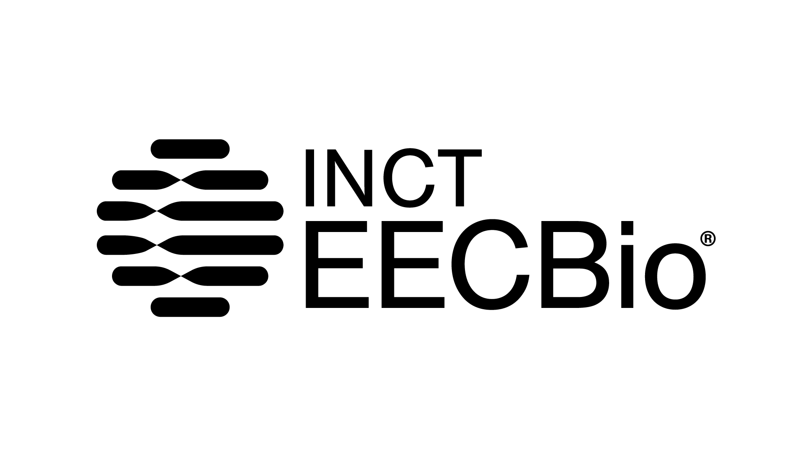

# __Softwares__

Nesta página estão listados os softwares atualmente disponíveis no servidor.

---

| Programa | Versão | Descrição |
|----------|:------:|-----------|
| BLAST+ | 2.X | Busca e comparação de sequências biológicas. |
| BUSCO | 5.X | Avaliação da completude de genomas e transcriptomas. |
| FastQC | X | Avaliação da qualidade de arquivos FASTQ. |

!!! note

    Caso necessite de um software que não esteja disponível, solicite sua instalação pela Central de Recursos.

    

© 2026 • LGBio • Universidade Federal de Goiás

